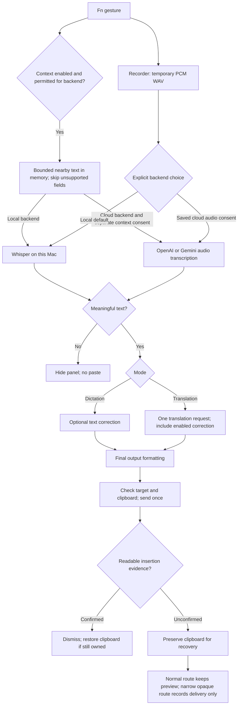

# Architecture / 架構與資料流

edgelesstype is a native macOS dictation app for Apple silicon. Speech recognition defaults to local Whisper. Explicitly consented OpenAI or Google Gemini transcription sends the completed recording to that provider; optional text correction and translation use separately selected providers. Insertion is checked against the focused editor rather than inferred from clipboard activity.

**範圍：M 系列 Mac、macOS 26 以上。** 本文件描述目前原始碼，不是跨平台框架設計。入口與限制見 [README](../README.md)。

## Dictation data flow

下圖涵蓋聽寫與翻譯。語音辨識後，翻譯模式在單次翻譯請求中整合已啟用的校正；失敗時不改貼中文。資料流與權限分開確認。

## Code map

| 責任 | 程式碼 | 修改時需保留的條件 |
|---|---|---|
| App 狀態、Fn 事件、錄音生命週期 | [main.swift](../Sources/EdgelessType/main.swift) | event-tap callback 先返回；錄音停止後清理暫存檔 |
| 原生收音與就緒提示音 | [Recorder.swift](../Sources/EdgelessType/Recorder.swift) | 第一段音訊寫入後才播起音；不裁掉開頭，停止後才播結束音 |
| 聽寫／翻譯狀態決策 | [Session.swift](../Sources/EdgelessTypeCore/Session.swift)、[Policy.swift](../Sources/EdgelessTypeCore/Policy.swift) | Fn+Shift 只開始翻譯，單按 Fn 結束 |
| 常駐本機辨識 | [ResidentSpeechEngine.swift](../Sources/EdgelessType/ResidentSpeechEngine.swift) | localhost、每次啟動 token、父程序退出後停止 worker |
| 選用錄音上下文 | [RecordingContextReader.swift](../Sources/EdgelessType/RecordingContextReader.swift)、[RecordingContext.swift](../Sources/EdgelessTypeCore/RecordingContext.swift) | 限制範圍、逾時略過、單次記憶體；雲端另行同意 |
| 取消處理 | [ProcessingCancellation.swift](../Sources/EdgelessTypeCore/ProcessingCancellation.swift) | 每次工作獨立取消，晚到回覆不得貼入下一筆 |
| 空白與標點攔截 | [SpeechContent.swift](../Sources/EdgelessTypeCore/SpeechContent.swift) | 不把純標點或已知空白標記當成文字；保留數字、程式碼與 emoji |
| 上下文校正 | [Vocabulary.swift](../Sources/EdgelessTypeCore/Vocabulary.swift) | 直接採用完整模型回覆；保留成功、完整、非空白檢查及繁體轉換 |
| 各家 API 協定 | [CloudProvider.swift](../Sources/EdgelessTypeCore/CloudProvider.swift) | 模型集中設定；認證不放 URL；拒絕截斷／拒答結果 |
| 金鑰與服務商 UI | [APISettingsWindow.swift](../Sources/EdgelessType/APISettingsWindow.swift)、[SecretStore.swift](../Sources/EdgelessTypeCore/SecretStore.swift) | 每家分開保存，錯誤不顯示原始回應或金鑰 |
| 寫入與結果確認 | [Paster.swift](../Sources/EdgelessType/Paster.swift)、[PasteConfirmation.swift](../Sources/EdgelessTypeCore/PasteConfirmation.swift) | 不以 AX setter 回傳值或剪貼簿讀取當作成功 |
| 被 wrapper 隱藏的游標 | [WebKitFocus.swift](../Sources/EdgelessType/WebKitFocus.swift) | 可選的 runtime symbols；找不到時不可按 wrapper 按鈕碰運氣 |
| 非搶焦點提示框 | [RecordChrome.swift](../Sources/EdgelessType/RecordChrome.swift) | 不成為 key/main window |
| 三種提示音與記憶選擇 | [SoundSettings.swift](../Sources/EdgelessTypeCore/SoundSettings.swift)、[SoundPlayer.swift](../Sources/EdgelessType/SoundPlayer.swift) | 同次錄音使用同一組開始／結束音；試聽可取消 |

模組名稱統一為 `EdgelessType`、`EdgelessTypeCore` 與 `EdgelessTypeTests`；產品名稱為 **edgelesstype**。既有 App 識別碼及本機語音引擎通訊欄位是保留的相容性契約，不是待改名的 Swift 模組。

## Privacy boundaries

- **錄音**：暫存 PCM WAV。預設交給本機 Whisper；只有明確選擇並同意雲端辨識時，才送至固定的 OpenAI 或 Google 端點。處理後刪除本機暫存檔。雲端辨識遇到暫時性失敗（空白或不完整回覆、服務忙、逾時、斷線）時自動重送同一段錄音一次；仍失敗時，錄音只留在記憶體，直到失敗提示關閉為止，按「重試」才寫回暫存檔再送一次。
- **貼上驗證快照**：僅在本機記憶體用於貼入前後比對，不作為雲端校正輸入。
- **錄音上下文**：與貼上快照分開。使用者開啟後非同步讀取游標附近最多 160 個 UTF-16 單位，供常駐本機 Whisper；雲端模式須額外同意才擷取並附在轉寫 prompt（Gemini Transcribe 沒有 prompt 欄位，不送）。原始文字不存檔、不另外傳送校正／翻譯；若被模型帶入逐字稿，後續雲端文字處理可能收到。
- **雲端文字處理**：轉寫文字、已啟用的字典和固定提示詞。字典的內部 UUID 與空欄位不送出。音訊是否上傳由上一項獨立決定。
- **API 金鑰**：加密存檔；解密金鑰表留在使用者本機設定目錄。兩者不加入公開來源包。
- **診斷**：時間、程序狀態及校正結果類型，不保存錄音、轉寫內容或剪貼簿原文。
- **剪貼簿**：有效轉寫在需要貼入時會成為系統剪貼簿內容；確認插入後，由 [ClipboardLease](../Sources/EdgelessType/ClipboardLease.swift) 還原記憶體中的先前內容，僅在 changeCount 仍屬於此次發布時執行。未確認或已被其他複製取代時不還原；備份不寫檔、不上傳。

細節與發布邊界見 [SECURITY.md](../SECURITY.md)。

## Design boundaries

這個專案把可測試的政策與 API 協定抽到 Core，原生視窗和系統整合留在 App 層。Controller 仍集中於 `main.swift`；這是目前的結構，不宣稱已實作完整框架或全面解耦。

目前的貼入驗證是有證據的 best effort，並非跨 App 的交易協定。當目標不提供可讀取文字、焦點已改變、權限不完整或元件變更時，可能需要手動貼上。請一起閱讀 [相容性與已知限制](COMPATIBILITY.md) 和 [問題索引](TROUBLESHOOTING.md)。

## Optional first-stage cloud transcription

The speech backend is selected separately from text correction. The default uses local Whisper. Explicitly consented OpenAI mode uploads the just-completed WAV recording to the fixed transcription endpoint using `gpt-transcribe`. Two Google modes send the same WAV inline (base64) with the stored Google key: Gemini Transcribe posts to the Interactions API with `gemini-3.5-transcribe` (smart mode, dictionary words as custom vocabulary) and its transcript enters the normal correction stage; Gemini one-pass posts to `gemini-3.8-flash` generateContent with the correction prompt and dictionary, and its reply is already corrected text, so no separate correction request follows (timing outcome `merged`). No backend ever silently falls back to another. All results enter the same final-output pipeline. Dictation can use full-text correction; translation combines enabled correction into its translation request. `Config/transcription.json` stores the backend choice, audio consent, recording-context preference and separate cloud-context consent, never captured text. See [privacy boundaries](../SECURITY.md).

## Processing, signing and local updates

[ProcessingStage](../Sources/EdgelessTypeCore/ProcessingStage.swift) separates recording from upload/recognition/correction/translation UI. [PrivateHTTPDelegate](../Sources/EdgelessTypeCore/PrivateHTTPDelegate.swift) collects only numeric timing and upload progress when available; reusable ephemeral clients keep no persistent response cache, cookies or credential storage.

The public checkout is the canonical source. The private runtime is updated one-way through [update-local-app.py](../Scripts/update-local-app.py), using the user's own fixed signing identity. Neither signing private keys nor runtime settings belong in public source or CI. See [local signing](LOCAL-SIGNING.md) and the [engineering lessons](ENGINEERING-LESSONS.md).
