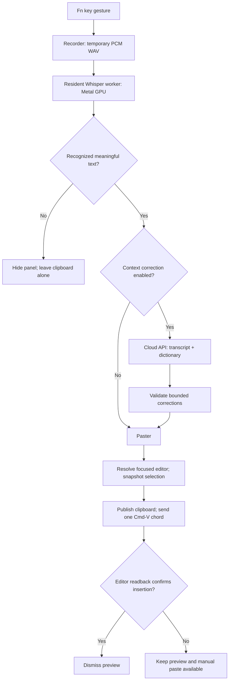

# Architecture / 架構與資料流

edgelesstype is a native macOS dictation app for Apple silicon. Speech recognition stays local. Optional cloud APIs receive text and vocabulary, never the recorded audio. Insertion is checked against the focused editor rather than inferred from clipboard activity.

**範圍：M 系列 Mac、macOS 26 以上。** 本文件描述目前原始碼，不是跨平台框架設計。入口與限制見 [README](../README.md)。

## Dictation data flow

下圖是聽寫流程。翻譯模式另走 `Policy.waitForEnglish`：雲端翻譯成功才貼入，不會在失敗時改貼中文。

## Code map

| 責任 | 程式碼 | 修改時需保留的條件 |
|---|---|---|
| App 狀態、Fn 事件、錄音生命週期 | [main.swift](../Sources/OpenTypeless/main.swift) | event-tap callback 先返回；錄音停止後清理暫存檔 |
| 聽寫／翻譯狀態決策 | [Session.swift](../Sources/OpenTypelessCore/Session.swift)、[Policy.swift](../Sources/OpenTypelessCore/Policy.swift) | Fn+Shift 只開始翻譯，單按 Fn 結束 |
| 常駐本機辨識 | [ResidentSpeechEngine.swift](../Sources/OpenTypeless/ResidentSpeechEngine.swift) | localhost、每次啟動 token、父程序退出後停止 worker |
| 空白與標點攔截 | [SpeechContent.swift](../Sources/OpenTypelessCore/SpeechContent.swift) | 不把純標點或已知空白標記當成文字；保留數字、程式碼與 emoji |
| 上下文校正 | [Vocabulary.swift](../Sources/OpenTypelessCore/Vocabulary.swift) | 不直接接受模型重寫全文；保留中英夾雜 |
| 各家 API 協定 | [CloudProvider.swift](../Sources/OpenTypelessCore/CloudProvider.swift) | 模型集中設定；認證不放 URL；拒絕截斷／拒答結果 |
| 金鑰與服務商 UI | [APISettingsWindow.swift](../Sources/OpenTypeless/APISettingsWindow.swift)、[SecretStore.swift](../Sources/OpenTypelessCore/SecretStore.swift) | 每家分開保存，錯誤不顯示原始回應或金鑰 |
| 寫入與結果確認 | [Paster.swift](../Sources/OpenTypeless/Paster.swift)、[PasteConfirmation.swift](../Sources/OpenTypelessCore/PasteConfirmation.swift) | 不以 AX setter 回傳值或剪貼簿讀取當作成功 |
| 被 wrapper 隱藏的游標 | [WebKitFocus.swift](../Sources/OpenTypeless/WebKitFocus.swift) | 可選的 runtime symbols；找不到時不可按 wrapper 按鈕碰運氣 |
| 非搶焦點提示框 | [RecordChrome.swift](../Sources/OpenTypeless/RecordChrome.swift) | 不成為 key/main window |
| 三種提示音與記憶選擇 | [SoundSettings.swift](../Sources/OpenTypelessCore/SoundSettings.swift)、[SoundPlayer.swift](../Sources/OpenTypeless/SoundPlayer.swift) | 同次錄音使用同一組開始／結束音；試聽可取消 |

模組路徑保留早期的 `OpenTypeless` 名稱；對外產品名稱為 **edgelesstype**。

## Privacy boundaries

- **錄音**：暫存 PCM WAV，只交給本機 whisper.cpp worker，處理後刪除。
- **輸入框快照**：僅在本機記憶體用於貼入前後比對，不交給雲端校正。
- **雲端資料**：轉寫文字、字典和固定提示詞。字典的內部 UUID 與空欄位不送出。
- **API 金鑰**：加密存檔；解密金鑰表留在使用者本機設定目錄。兩者不加入公開來源包。
- **診斷**：時間、程序狀態及校正結果類型，不保存錄音、轉寫內容或剪貼簿原文。
- **剪貼簿**：有效轉寫在需要貼入時會成為系統剪貼簿內容；App 不把它描述成私密通道，也不以恢復舊剪貼簿掩蓋未完成貼入。

細節與發布邊界見 [SECURITY.md](../SECURITY.md)。

## Design boundaries

這個專案把可測試的政策與 API 協定抽到 Core，原生視窗和系統整合留在 App 層。Controller 仍集中於 `main.swift`；這是目前的結構，不宣稱已實作完整框架或全面解耦。

目前的貼入驗證是有證據的 best effort，並非跨 App 的交易協定。當目標不提供可讀取文字、焦點已改變、權限不完整或元件變更時，可能需要手動貼上。請一起閱讀 [相容性與已知限制](COMPATIBILITY.md) 和 [問題索引](TROUBLESHOOTING.md)。
