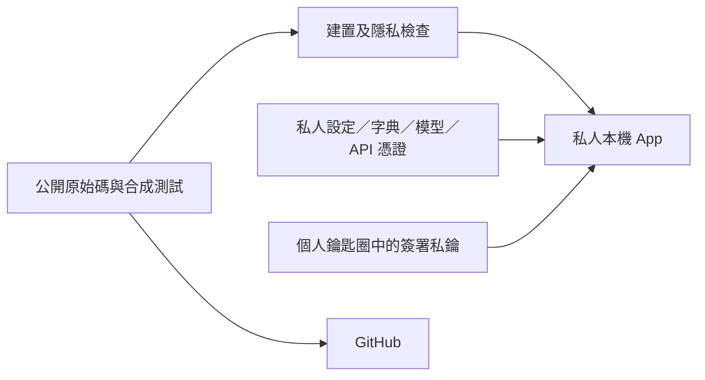

# 從症狀到證據：macOS 語音輸入 App 排錯實戰

本指南說明 edgelesstype 如何處理貼上相容性、更新後權限失效、App 副本混淆、等待時間與狀態介面。目的是讓開發者能重現判斷方法，不是繞過 macOS 安全機制。

本文使用通用路徑、合成資料與去識別化結論，保留可核對的公開程式碼連結。公開模組名稱與既有 Git 歷史仍可提供專案層級的關聯；這不是整個 repository 的匿名化或歷史清除。沒有實際使用者的畫面、聊天、錄音、字典、帳號、憑證指紋、金鑰或原始日誌。以下檔案路徑相對於公開原始碼專案；命令中的 `/path/to/...` 必須換成自己的位置。

## 1. 先把成功拆成不同層次

一個「語音輸入成功」至少包含：

1. 按鍵被 App 收到。
2. 麥克風啟動與停止。
3. 辨識得到有效文字。
4. 校正或翻譯回覆完整。
5. 文字實際插入正確輸入框，而且只有一次。
6. 預覽框按預定規則收起。

不要只看到最後一個畫面，就推論前面全部成功。HTTP 200 不代表文字正確；剪貼簿有字不代表輸入框收到；送出 Cmd+V 不代表成功貼上；預覽消失也不能代替目標內容的證據。

使用一張簡單的證據表：

| 層次 | 可接受證據 | 不能拿來替代的訊號 |
|---|---|---|
| 程式建置 | 編譯成功、自測通過 | App 圖示出現 |
| 簽署身分 | 簽章有效、新版本符合舊版本 requirement | 名稱或圖示相同 |
| 系統權限 | 系統允許、實際 event tap 建立成功 | 使用者按過某個「允許」 |
| 貼上 | 輸入框內容改變且只出現一次 | AX setter 成功、剪貼簿讀取 |
| 相容性 | 指定 App／欄位的原生測試或明確使用者回報 | 只有純邏輯 fixtures |
| 速度 | 同條件的分階段實測 | 少一次請求就宣稱快了某個百分比 |

## 2. 有預覽、手動貼上正常，自動貼上卻失敗

### 如何定位

先確認是否已有完整文字預覽，以及手動 Cmd+V 是否能插入。若兩者正常，優先看貼入流程，不要先重裝模型、重登雲端或改 API 金鑰。

接著檢查前景程序與焦點物件。有些 App 用網頁包裝原生視窗，輔助使用介面可能只暴露容器或按鈕，沒有可編輯文字欄。元件樹也可能隨版本或啟動狀態改變；一次沒看到 editor，不代表它永遠不提供。

### 最後採用的做法

一般路徑先解析真正的 editor，記錄文字／選取範圍，發布剪貼簿後只向核對過的前景程序送一次 Cmd+V，再讀回結果。文字範圍使用 UTF-16，而非 Swift 字元數。

對已驗證「一般貼上可用、AX 焦點可能不透明」的少數 App，採精確 bundle ID 白名單替代路徑：

- 原本的目標程序必須仍在前景。
- 剪貼簿必須仍屬於本次輸出，不能覆蓋使用者後來複製的內容。
- 只投遞一次按鍵，不掃描聊天紀錄、不猜測其他欄位、不點疑似傳送按鈕。
- 不按 Enter，也不在讀回失敗後自動重送。
- 無法讀回時，只能記錄「已投遞」，不能寫成「已確認插入」。

這條不透明路徑會在按鍵投遞後收起預覽，保留語音剪貼簿供手動補救；正常路徑則依讀回證據還原舊剪貼簿。兩者的保證不同。

### 哪些做法沒有解決問題

- 單憑 `AXUIElementSetAttributeValue` 成功就收框：呼叫被接受，不代表文字已變更。
- 剪貼簿被讀取就認定完成：讀取可能只是預先查看。
- 不斷重試 Cmd+V：可能造成延遲的雙重貼上。
- 把替代路徑開放給所有 App：會把已知相容性擴大成沒有證據的焦點猜測。

程式：[Paster](../Sources/EdgelessType/Paster.swift)、[PasteConfirmation](../Sources/EdgelessTypeCore/PasteConfirmation.swift)。測試：[貼上生命週期](../Scripts/test-paste-flow.py)。某個採用網頁介面的聊天客戶端，其自動貼上與收框有使用者實際成功回報；本文不列個別測試者的軟體清單，也不將這項回報寫成所有版本、所有欄位的自動化認證。

## 3. 同名 App 太多，重建後反而出現舊功能

### 根本區別：執行位置不等於建置來源

看到某個程序從私人目錄啟動，只能證明執行檔的位置。該執行檔可能是較新原始碼的建置結果，早已覆蓋到一份含舊 Sources 的工作目錄。

如果直接在那個目錄重新編譯，會用舊來源覆蓋新執行檔。只看資料夾名稱或 App 圖示都發現不了這種落差。

### 單一原始碼、單向安裝



私人資料沒有回流到 GitHub 的箭頭。功能只在公開原始碼維護；日常安裝只接收執行檔、必要中繼資料與固定公開資源。更新工具不複製私人設定，也不把私人目錄打包回專案。

`LOCAL-BUILD.json` 留在私人目錄，記錄來源版本、執行檔雜湊及簽署條件。它用來回答「這個 App 到底是哪份程式建出來」，不是公開診斷附件。

備份只保留非 App 格式的必要程式檔案，避免產生一整排可被搜尋器辨識為 App 的副本。清理舊 App 時先核對路徑與識別碼；不要因為名稱相同就刪除整個私人目錄。

程式：[本機更新工具](../Scripts/update-local-app.py)。測試：[私人資料保留與失敗回復](../Scripts/test-local-update.py)。

## 4. 為何每次更新都要重新授權

### 查身分，不只查簽章「有效」

```sh
codesign --verify --strict "/path/to/YourDictationApp.app"
codesign -d -r- "/path/to/YourDictationApp.app"
```

第一個命令確認目前檔案與簽章相符；第二個顯示 designated requirement，也就是系統辨識程式身分的條件。

臨時簽章的條件可能依賴該次建置的 `cdhash`。程式內容一改，雜湊就變，即使名稱與 bundle ID 相同，也不能據此保證舊授權仍匹配。

### 修復方式

讓每位使用者自行建立並保管本機程式簽署憑證，日常 App 使用固定的本機 bundle ID，更新時沿用同一把簽署私鑰。公開 CI 可以維持臨時簽章，不需要任何人的私鑰。

本機更新工具必須：

1. 在變更 App 前確認私人簽署設定存在。
2. 使用指定憑證簽署，禁止默默退回 `--sign -`。
3. 驗證新 App 的簽章。
4. 要求新版本符合原版本的 certificate-backed requirement。
5. 若不符合，回復原本已簽署的執行檔、中繼資料、資源與簽章檔；不能用臨時重簽掩蓋失敗。

實測方法是製作兩個內容不同的合成程式，用同一憑證簽署，確認兩者 requirement 相同，第二個能通過第一個的驗證，而且錯誤識別碼會被拒絕。這證明身分延續機制，不等於已模擬所有 macOS 權限政策。

注意 `codesign` 的內嵌條件用 `-R=`；不要把條件字串誤當成檔案路徑。不要把 requirement 簡化成「只要 bundle ID 一樣」以追求免授權，否則失去簽署者的限制。

### 兩種「允許」不要混淆

- 鑰匙圈讓 `codesign` 使用個人簽署私鑰，與 App 的鍵盤監聽是兩件事。只按一次「允許」可能導致下一次簽署再次詢問；是否讓 `codesign` 持續使用該專用金鑰，由使用者在系統視窗決定。
- 輔助使用、輸入監控與麥克風是執行期權限。首次改用固定身分，仍可能需要本人重新核准。

完整操作見[個人本機簽署指南](LOCAL-SIGNING.md)。自簽憑證不是 Apple Developer ID，也不是公證；不能用它宣稱公開二進位已受 Apple 認證。憑證更換、權限撤銷與系統政策變動仍可能要求再次授權。

## 5. 明明選對 App，權限清單卻沒有出現

### 一個檔案，可能有四份身分資訊

核對以下資料是否一致：

| 來源 | 檢查重點 |
|---|---|
| `Contents/Info.plist` | `CFBundleIdentifier` 與顯示名稱 |
| `codesign -d -r-` | 實際簽署的 identifier 與憑證條件 |
| LaunchServices | 哪個識別碼對應哪個 App URL |
| Spotlight | 檔案索引保存的 bundle ID／顯示名稱 |

```sh
mdls -name kMDItemCFBundleIdentifier -name kMDItemDisplayName "/path/to/YourDictationApp.app"
```

曾觀察到 App 內部與 LaunchServices 已更新，但 Spotlight 和長時間開著的選檔流程仍帶入舊識別碼。結果是選到正確檔案，權限系統卻查找已不存在的舊 App。

### 修復與驗證

只改包內的執行檔／Info.plist，未必更新 App 外層資料夾時間。更新工具因此也刷新 bundle 時間、重新登記 LaunchServices，並針對該 App 重新匯入 Spotlight。這不改寫 TCC、不授予權限，也不關閉任何系統防護。

索引可能非同步完成。應先重新讀取識別碼，確認一致，再開新的選檔流程；不要只看到匯入命令退出成功就要求使用者重試。更不要因為一份舊副本的開關是開啟，就說目前程式已有權限。

驗證分兩層：在清單看到正確的日常 App 且開關開啟；再確認該程序能建立事件監聽。若工具自己還快取舊 App ID，工具的「找不到」不能直接當成作業系統無法啟動。

**失敗教訓：**重複要求使用者選相同檔案、反覆重建或例行重設權限，沒有消除索引矛盾，還增加了干擾。先找到可比對的身分差異，再做局部刷新。

## 6. 「上傳很慢」不一定慢在上傳

從停止錄音到可貼上，至少包含：關閉錄音檔、建立連線、送出音訊、等待辨識、接收結果、文字校正／翻譯及貼上。

如果只記錄整個辨識呼叫，不能把它命名為上傳耗時。現在使用 Foundation 的交易時間與 body 傳送進度，能取得時分別記錄：

- 請求送出時間。
- 請求完成到收到第一個回應位元組的等待。
- 連線建立時間。
- 辨識整體耗時、校正耗時、翻譯耗時。

回應等待包含網路傳輸、排隊與伺服器工作，不能宣稱是純模型運算。量測不可得就留空，不用零或假百分比代替。

### 已採用的兩項結構改善

**連線重用：**保留 ephemeral URLSession，讓系統有機會重用連線；不保存磁碟快取、Cookie 或 URLCredentialStorage。Authorization 仍是每個 request 自己的 header，不放 session 的共用預設值。重用連線不保證伺服器或網路永遠保留它。

**合併中翻英：**當上下文校正啟用時，讓同一個翻譯請求處理辨識錯字與英文翻譯，附帶相同字典資料；取消原先必須先等一輪校正、再等翻譯的串接。一般聽寫保留原本校正；關閉校正時也不偷偷加入字典。沒有自動更換服務商、模型或推理設定。

這些改變有請求與邏輯測試，但沒有對所有真實帳戶的品質／延遲保證。合併提示詞可能改變模型表現，仍須用非私人固定案例評估。沒有以降低 timeout、截斷長文或先貼半成品來冒充加速。

校正請求現在也記錄連線、上傳與回應等待，只記數字，不記內容、網址或 request ID。多段校正保留第一次連線時間，並把後面的等待加總。錄音開始且上下文校正開啟時，若網路可用且不是離線探測，對目前服務商的 host 根路徑發一個不帶金鑰、不帶內容的 HEAD，讓同一個 ephemeral session 有機會先建好連線；同一 host 60 秒內只發一次，回應丟棄。路徑顯示離線時不送校正，直接貼原文。真實雲端的推理強度比較仍須使用者允許，fixtures 不呼叫雲端。

後續評估請使用相同模型、相近長度的非敏感語句，分開比較冷連線與重用連線，多次記錄中位數與尾端等待；一次快或慢不足以建立結論。真實雲端測試需要使用者明確允許傳送該測試內容，fixtures 本身不呼叫雲端。

程式：[PrivateHTTPDelegate](../Sources/EdgelessTypeCore/PrivateHTTPDelegate.swift)、[CloudProvider](../Sources/EdgelessTypeCore/CloudProvider.swift)、[CloudRecovery](../Sources/EdgelessTypeCore/CloudRecovery.swift)、[Transcription](../Sources/EdgelessTypeCore/Transcription.swift)、[ProcessingPlan](../Sources/EdgelessTypeCore/ProcessingStage.swift)。測試：[ProcessingSpeedTests](../Tests/EdgelessTypeTests/ProcessingSpeedTests.swift)。

## 7. 停止錄音後還像在錄音，是介面狀態錯誤

原介面在 recording 與 working 共用波形和按鈕，只改波形高度。使用者無法清楚知道麥克風是否已停止，也無法知道正在等哪一段。

新的狀態契約：

| 狀態 | 視覺與文字 | 觸發條件 |
|---|---|---|
| 錄音 | 波形、停止／取消控制 | 麥克風正在收音 |
| 傳送音訊 | 藍色 spinner、階段文字、已停止錄音、可得的百分比 | 正在送出 body |
| 語音辨識 | spinner、辨識文字、經過秒數 | 本機辨識，或雲端 body 已送完 |
| 校正 | spinner、校正文字 | 一般聽寫的校正請求 |
| 翻譯 | spinner、翻譯文字 | 中翻英請求 |
| 可貼上 | 文字預覽與手動補救提示 | 有完整可用結果 |

錄音器先停止並關閉檔案，再顯示「錄音已停止」。不使用假的進度條；總等待時間不因切換處理階段而歸零。狀態變更在主佇列執行，錄音提示框維持不搶焦點。校正或翻譯超過 3 秒可先貼原文（點按鈕或再短按一次 Fn，兩者等效；按鈕出現前的 Fn 仍忽略，避免誤觸），只中止雲端步驟。雲端辨識（上傳到回覆，含自動重送）超過 5 秒則浮出「改用本機 · Fn」，取消雲端請求並以本機 Whisper 辨識同一段錄音，之後不再做雲端校正；按鈕出現時先在背景載入本機引擎。結果提示改在螢幕上方，不蓋住輸入框；成功不顯示提示。

介面渲染檢查可以只用固定文字，不必截取私人桌面或字典。渲染通過仍不代表已驗證真實麥克風／網路的時序。

程式：[RecordChrome](../Sources/EdgelessType/RecordChrome.swift)、[NoticePanel](../Sources/EdgelessType/NoticePanel.swift)、[main](../Sources/EdgelessType/main.swift)。句尾格式統一在 [OutputPolicy](../Sources/EdgelessTypeCore/OutputPolicy.swift) 的最終輸出處理：去除最末尾中英句點，保留中間標點；不靠修改模型提示詞來猜測是否遵守。

## 8. 如何把修正公開，又不公開私人環境

發布前應同時檢查：

1. **檔案集合：**只發布白名單中的程式、測試、文件及公開資源，排除 runtime 設定、錄音、模型、App 與備份。
2. **檔案內容：**排除私人路徑、Email、金鑰格式、私鑰區塊、私人字典及真實測試內容。
3. **Git 中繼資料：**作者／提交者使用批准的公開別名與 noreply Email；公開 diff 與提交訊息也不能附私人日誌。
4. **證據寫法：**把個別使用紀錄轉成去識別化的「哪一層已驗證、哪一層尚未驗證」，不要直接貼原始截圖或紀錄檔。
5. **歷史風險：**`.gitignore` 不會移除已追蹤檔案，也不會清除舊提交；若曾洩漏秘密，需另行處理撤銷與歷史清理，不能只刪目前檔案。

```sh
python3 Scripts/test-core.py
python3 Scripts/test-paste-flow.py
python3 Scripts/test-local-update.py
python3 Scripts/test-local-signing-config.py
python3 Scripts/check-docs.py
python3 Scripts/public-check.py
git diff --cached --check
```

有建置 App 時再跑 `public-check.py --app-only`。公開來源包只透過白名單工具產生，不壓縮整個工作目錄。自動掃描是防線，不是絕對匿名保證。

## 9. 本輪證據與仍未證實的事

- 核心、貼上生命週期、簽署設定與更新回復有可重跑的合成測試。
- 兩個不同合成程式可通過相同憑證身分驗證；後續本機更新也已通過原 requirement。
- 真實權限清單已觀察到日常 App，且更新後的 event tap 能啟動；不能擴大成所有 macOS 版本永不重問。
- 聊天客戶端的自動貼上與收框包含使用者實測成功回報，與純邏輯測試分開記錄；本文不將該回報與個人工作流連結。
- 處理狀態有原生繪圖預覽檢查；整體速度沒有公開真人錄音基準，也沒有宣稱特定百分比提升。

接手者先讀 [AGENTS.md](../AGENTS.md)、[AI-GUIDE](AI-GUIDE.md) 與 [knowledge-index](knowledge-index.json)，再選與症狀相符的最小修正。保持「觀察 → 假設 → 有界測試 → 結果 → 限制」的順序，比持續增加權限、重試或猜測更可靠。

## 參考資料

- [Apple：Code Signing Tasks](https://developer.apple.com/library/archive/documentation/Security/Conceptual/CodeSigningGuide/Procedures/Procedures.html)
- [Apple：TN2206，Code Signing In Depth](https://developer.apple.com/library/archive/technotes/tn2206/_index.html)
- [Apple：URLSession body 傳送進度](https://developer.apple.com/documentation/foundation/urlsessiontaskdelegate/urlsession(_:task:didsendbodydata:totalbytessent:totalbytesexpectedtosend:))
- [Apple：URLSessionTaskTransactionMetrics](https://developer.apple.com/documentation/foundation/urlsessiontasktransactionmetrics)


## 可取消的處理面板

處理中的轉圈圖示不能取代使用者的退出控制。上傳、辨識、校正與翻譯共用右側圓形「取消處理」按鈕，維持黑色圓角面板及藍色進度圖示；按鈕使用原生可及性標籤。

只把面板藏起來會讓背景請求繼續執行，甚至在使用者開始下一筆錄音後貼上舊文字。因此每筆工作都有獨立取消記號、設定快照及目標視窗；取消時中止該筆網路請求或本機辨識程序。所有回到主執行緒的進度、錯誤、貼上與完成回呼，都必須再次核對工作身分。舊工作的清理不得重設新工作的忙碌狀態。

測試以模擬網路等待驗證文字及音訊請求可取消、重複取消不重複執行回呼、取消不影響下一筆工作。另檢查既有貼上流程。這些測試不使用私人錄音、不呼叫實際雲端服務，也不代表雲端已收到的工作或費用能撤銷。
